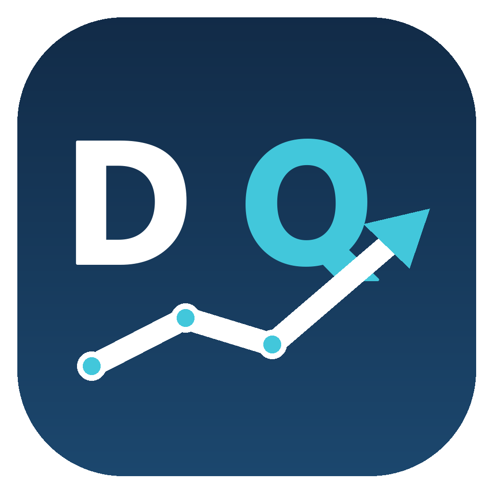

# DART-QoE

<p align="center">
  
</p>

<p align="center">
  <strong>공시 기반 정상화 이익·운전자본 검토 보조 도구</strong><br>
  Disclosure-Based Quality of Earnings Review Tool
</p>

DART 공시 재무제표와 사업보고서의 연결·별도 재무제표 주석을 이용해 인수 검토 대상 기업의 **이익 지속성, 현금전환, 운전자본과 순차입금**을 살펴보는 Windows 데스크톱 PoC입니다.

자동으로 정상화 이익이나 기업가치를 확정하는 프로그램이 아닙니다. 거래 검토자가 추가로 확인할 지표, 정상화 조정 후보, 공시 원문과 계산 근거를 빠르게 찾도록 설계했습니다.

## 프로젝트 목적

공시상 이익이 증가했더라도 그 성과가 지속 가능한 영업활동에서 발생했는지는 별도의 검토가 필요합니다. DART-QoE는 다음 질문에서 출발합니다.

- 이익 증가가 영업현금흐름으로 전환되고 있는가?
- 매출 증가보다 매출채권이나 재고가 더 빠르게 증가하고 있지 않은가?
- 손상차손, 처분손익, 구조조정비용 등 보고이익에서 별도 검토할 항목이 포함되어 있지 않은가?
- 현금과 차입금을 함께 고려한 실질적인 자금 상태는 어떻게 변했는가?
- 계산 결과를 어떤 공시와 계정에서 가져왔는지 다시 확인할 수 있는가?

이 프로젝트는 `한화–대우조선해양 M&A 사례 분석 → DART-QoE 거래 검토 방식 구현 → DART-OT 이자비용 감사 검토`로 이어지는 포트폴리오 흐름을 목적으로 합니다. 실제 거래실사 수행 경험이 아니라, 공시자료를 활용해 거래 검토 사고방식을 구현한 개념검증입니다.

## 주요 기능

### 1. 보고이익과 현금전환

- 매출액 또는 영업수익
- 매출 성장률
- 영업이익과 영업이익률
- 영업활동현금흐름
- 영업이익 대비 영업현금흐름
- 순이익과 영업현금흐름의 괴리
- QoE 요약 차트: 왼쪽 축은 보고·정상화 영업이익 금액, 오른쪽 축은 영업현금흐름/영업이익(%). 두 축의 의미는 차트 하단 좌우 여백에 가로로 표시합니다. 조정 전후 영업이익이 같아도 두 계열을 구분할 수 있도록 보고 영업이익은 파란 실선, 정상화 영업이익은 주황 점선으로 표시합니다.

화면 요약에는 비교 기준을 명확히 하기 위해 `2021년 금액 → 2025년 금액`처럼 연도와 값을 함께 표시합니다.

### 2. 운전자본

- 매출채권회전일수
- 재고자산회전일수
- 매입채무회전일수
- 현금전환주기
- 순운전자본
- 매출 대비 순운전자본
- 매출채권·재고 증가율과 매출 증가율의 차이

### 3. 순차입금

- 차입금과 사채
- 현금및현금성자산
- 리스부채 포함 여부 선택
- 연도별 순차입금 추이

현재는 영업이익 기준 PoC입니다. 감가상각비와 무형자산상각비의 안정적인 추출을 추가한 뒤 EBITDA 및 순차입금/EBITDA 분석으로 확장할 예정입니다.

### 4. 정상화 조정 검토 후보

다음 7개 유형을 모든 분석에서 기본 탐색합니다. 먼저 재무제표 API의 손익계산서·포괄손익계산서 계정명을 확인하고, 같은 연도의 사업보고서 원문에서 실제 사용 기준에 맞는 연결감사보고서 또는 감사보고서의 재무제표 주석을 추가로 확인합니다. 이 원문 주석 탐색은 별도 선택사항이 아닙니다.

1. **자산 처분·폐기손익**: 유형자산·무형자산·투자부동산·종속기업·사업부 처분손익, 매각손익, 폐기손실
2. **자산 손상·환입**: 유형자산·무형자산·영업권·사용권자산 손상차손 및 손상차손환입
3. **구조조정·인력 감축 비용**: 구조조정비용, 사업장·공장 폐쇄비용, 희망퇴직·명예퇴직·특별퇴직 비용, 퇴직위로금, 해고급여
4. **기업결합·거래·통합 비용**: 인수·합병·기업결합 관련 비용, 거래비용, PMI·통합비용
5. **소송·규제·재해 관련 손익**: 소송손실, 합의금, 배상금, 과징금, 과태료, 벌금, 제재금, 화재·재해·사고손실과 관련 보험보상수익
6. **중단영업·사업 철수 손익**: 중단영업손익, 사업부 매각손익, 영업중단·철수손실
7. **손실부담계약·계약 종료 비용**: 손실부담계약손실, 계약해지손실, 위약금, 계약 종료·철수 관련 충당부채

재무제표 API 후보는 손익계산서·포괄손익계산서의 금액 있는 계정만 사용합니다. 사업보고서 주석에서는 표의 첫 번째 계정 셀이 7개 유형의 계정명과 직접 일치하고 단위와 당기 금액을 확인할 수 있는 행을 사용합니다. 유형자산·무형자산 등 다열 변동표는 `당기` 표의 구성항목 합계가 마지막 `계` 열과 일치할 때만 합계 금액을 반영합니다. 비교연도 표, 사업부문별 표, 금융자산 손상, 미처분이익잉여금, 손상차손누계액 등은 후보에서 제외합니다. 추출 금액은 원 단위의 양수로 표시하고, `손익 방향`에서 이익·손실 여부만 제시합니다.

재무제표 API와 사업보고서 주석에서 실제 계정과 금액이 확인된 후보만 표시합니다. 해당 연도에 존재하지 않거나 금액을 검증할 수 없는 유형은 빈 `사용자 확인 필요` 행으로 만들지 않습니다. `검토 근거/메모`는 맨 뒤 열에 빈 입력칸으로 제공합니다.

재고자산평가손실·대손상각비·품질보증충당부채·정부보조금·관계기업·지분법·일반 기타수익·기타비용은 반복 가능하거나 영업이익 밖의 항목이므로 정상화 손익 후보에서 추출하지 않습니다.

탐지된 강한 일회성 후보는 Excel에서 `사용자 판단=일회성`, `조정 여부=예`로 초기 반영됩니다. 중단영업·사업 철수 손익은 `정상화 대상=순이익`, 나머지 유형은 `정상화 대상=영업이익`으로 제시합니다. 영업이익 대상의 일회성 손실은 보고 영업이익에 가산되고 일회성 이익은 차감되어 정상화 영업이익이 즉시 계산됩니다. 다만 자동 탐지 결과는 확정 조정액이 아니므로 원문 확인 결과 반복 항목이거나 보고 영업이익에 포함되지 않았다면 사용자가 `아니요` 또는 `제외`로 변경해야 합니다.

Excel의 `검토 후보` 시트에서 사용자가 다음 항목을 입력하면 `정상화 손익` 시트와 `QoE 요약`이 자동으로 다시 계산됩니다.

1. 자동 반영된 손익 방향·금액·원문을 확인
2. 반복 항목이면 `사용자 판단=반복`과 `조정 여부=아니요`로 변경
3. 보고 영업이익에 포함되지 않은 항목이면 `정상화 대상=제외` 또는 `조정 여부=아니요`로 변경
4. 적용 금액과 조정 사유 입력

정상화 영업이익에는 `사용자 판단=일회성`, `정상화 대상=영업이익`, `조정 여부=예`이고 손익 방향이 확인된 항목만 반영됩니다. 손실은 가산하고 이익은 차감합니다.

상단 `전체 조정 여부`의 기본값은 `예`이며 모든 강한 일회성 후보를 정상화 영업이익에 반영합니다. `아니요`를 선택하면 전체 후보를 한 번에 제외할 수 있습니다. `검증` 시트는 조정 여부가 `예`이지만 반영 조건을 충족하지 못한 항목 수를 표시합니다.

`정상화 손익`과 `QoE 요약`은 확정 조정액과 함께 `정상화 판단 미완료 후보 수`를 표시합니다. 따라서 조정액이 `-`여도 미완료 후보가 남아 있으면 “조정사항 없음”이 아니라 원문 확인과 사용자 판단이 남아 있는 상태입니다.

### 5. 검토 흔적

결과 엑셀에 다음 정보를 남깁니다.

- 사용한 사업보고서와 접수번호
- DART 원문 주소
- 연결·별도재무제표 기준
- 원천 계정과 자동 추출 여부
- 지표별 계산식
- 검토 상태
- 사용자 조정 여부와 사유
- 연도별 추출 오류와 제한사항

## 분석 범위

- 국내 DART 공시 대상 상장사
- 회사명 또는 종목코드 검색
- 분석기간 자유 설정
- 기본 분석기간: 2021~2025년
- 연결재무제표 우선
- 연결 자료가 없으면 별도재무제표로 자동 전환
- 연도별 기준이 다르면 혼합 기준으로 표시
- 순차입금 계산 시 리스부채 포함 여부 선택

제조업 상장사를 우선적인 테스트 대상으로 삼았지만, 계정 구조가 다른 바이오·연구개발 기업 등도 분석할 수 있습니다. 이 경우 `매출액` 대신 `영업수익`이 선택되는 등 회사별 표시 계정과 사업 특성을 함께 확인해야 합니다.

## 사용 방법

Windows 배포본에서는 `DART-QoE.exe` 하나만 실행합니다. 브라우저나 로컬 웹 서버를 사용하지 않는 독립형 데스크톱 프로그램입니다.

1. OpenDART 인증키를 입력합니다.
2. 회사명 또는 종목코드를 입력합니다.
3. 분석기간을 선택합니다.
4. 순차입금에 리스부채를 포함할지 선택합니다.
5. `공시 분석 및 Excel 만들기`를 실행합니다. Enter 키로도 실행할 수 있습니다.
6. 화면에서 핵심 지표와 추가 확인 포인트를 확인합니다.
7. 생성된 Excel의 `검토 후보`에서 반복성·정상화 대상·조정 여부·적용 금액과 사유를 입력합니다.
8. `정상화 손익`과 `QoE 요약`에서 사용자 조정 후 결과를 확인합니다.

결과 파일은 실행파일과 같은 위치의 `outputs` 폴더에 저장됩니다.

### v0.3.0 화면 개선

- 넓은 창은 분석 조건과 검토 결과를 나란히, 좁은 창은 위아래로 배치합니다.
- 작은 화면에서는 세로 스크롤로 모든 입력과 결과에 접근할 수 있습니다.
- 필수 입력과 잘못된 기간은 해당 카드 안에서 안내하고 입력값을 유지합니다.
- 한글 입력칸의 Tab·Shift+Tab 이동과 Enter 실행을 지원합니다.
- 결과 영역에는 사용 순서, 실제 진행률, 오류 복구 안내와 결과 스크롤바가 표시됩니다.
- 로고와 서명은 작은 푸터로 정리해 분석 입력과 결과에 더 많은 공간을 사용합니다.

배포 실행파일은 [GitHub Releases](https://github.com/JoonseokWon/DART-QoE/releases)에서 받을 수 있습니다.

제품 명세·화면 설계·검증 결과는 [docs/spec.md](docs/spec.md), [docs/design.md](docs/design.md), [docs/handoff.md](docs/handoff.md)에 기록합니다.

### 인증키 저장

`이 PC에 암호화하여 저장`을 선택하면 인증키는 `%APPDATA%\DART-QoE\api-key.dat`에 저장됩니다.

Windows DPAPI를 사용하므로 저장된 값은 현재 Windows 사용자 계정에서만 복호화할 수 있습니다. 인증키 원문을 프로젝트 파일이나 결과 Excel에 기록하지 않습니다.

### 실행 안정성

- 프로그램은 Windows 세션에서 한 번에 하나만 실행됩니다.
- 실행 중 다시 열어도 중복 창을 만들지 않습니다.
- PyInstaller 임시 압축 해제 충돌을 방지하기 위해 패키지 실행파일의 자기 업데이트 기능은 사용하지 않습니다.
- 새 실행파일 배포 시 기존 앱을 종료한 후 파일을 교체하고 다시 실행합니다.

## 화면 결과

분석 완료 후 화면에는 세부 표 전체가 아니라 의사결정에 필요한 요약을 표시합니다.

- 분석기간과 재무제표 기준
- 추출 오류 또는 제한사항
- 시작연도와 종료연도의 매출·영업이익률 비교
- 최근 연도 영업현금 전환율
- 최근 연도 매출 대비 순운전자본
- 최근 연도 순현금 또는 순차입금
- 정상화 조정 검토 후보 수
- 정상화 손익 계산 방법 안내
- 추가 확인이 필요한 지표

화면은 빠른 검토용이며, 세부 내용의 기준 문서는 생성된 Excel입니다.

## Excel 구성

| 시트 | 내용 |
|---|---|
| `표지` | 분석 목적, 회사, 기간, 재무제표 기준, 단위와 사용 순서 |
| `원천 자료` | DART 재무제표 추출값, 추출 기준과 사용자 메모 |
| `QoE 요약` | 보고 영업이익과 사용자 조정 후 정상화 영업이익, 현금전환과 순차입금 |
| `정상화 손익` | 손익 방향·반복성·정상화 대상 검토, 가산·차감 조정액, 정상화 영업이익과 이익률 |
| `운전자본` | 회전일수, 현금전환주기, 순운전자본과 검토 포인트 |
| `순차입금` | 현금·차입금·리스부채 구성, 순차입금·순현금과 전년 대비 증감 |
| `검토 후보` | 유형, 계정·키워드, 금액, 원문 발췌, 반복성 힌트와 사용자 판단란 |
| `검토 흔적` | 사용 공시, 접수번호, 원문 주소, 재무제표 기준과 산식 |
| `검증` | 데이터 완전성, 연결 기준 여부, 오류와 제한사항 |

## 주요 산식

| 지표 | 산식 |
|---|---|
| 영업이익률 | 영업이익 ÷ 매출액 |
| 영업이익 대비 영업현금흐름 | 영업활동현금흐름 ÷ 영업이익 |
| 순이익–영업현금흐름 괴리 | 순이익 - 영업활동현금흐름 |
| 매출채권회전일수 | 평균 매출채권 ÷ 매출액 × 365 |
| 재고자산회전일수 | 평균 재고자산 ÷ 매출원가 × 365 |
| 매입채무회전일수 | 평균 매입채무 ÷ 매출원가 × 365 |
| 현금전환주기 | 매출채권회전일수 + 재고자산회전일수 - 매입채무회전일수 |
| 순운전자본 | 매출채권 + 재고자산 - 매입채무 |
| 순차입금 | 차입금·사채 + 선택 시 리스부채 - 현금및현금성자산 |
| 정상화 순조정액 | `일회성·영업이익·조정 예`로 확인된 손실 가산액 - 이익 차감액 |
| 정상화 영업이익 | 보고 영업이익 + 정상화 순조정액 |
| 정상화 영업이익률 | 정상화 영업이익 ÷ 매출액 |

분모가 없거나 영업손실인 경우 일부 비율은 경제적으로 해석하기 어렵습니다. 특히 적자기업은 순차입금/EBITDA보다 현금 소진 속도와 순현금 비중을 함께 보는 것이 적절할 수 있습니다.

## 데이터 처리 흐름

```text
회사명·종목코드
        ↓
DART 기업 고유번호 확인
        ↓
연도별 연결재무제표 조회
        ↓ 연결 자료 미제공
연도별 별도재무제표 재조회
        ↓
사업보고서 연결·별도 재무제표 주석과 리스부채 공시 확인
        ↓
재무지표 계산·검토 후보 탐색
        ↓
화면 요약 + 검토 흔적이 포함된 Excel 생성
```

## 기술 구성

- Python 3.12
- Tkinter 기반 Windows 데스크톱 UI
- Windows 네이티브 입력 컨트롤을 이용한 한글 IME 처리
- OpenDART REST API
- Node.js
- `@oai/artifact-tool`을 이용한 Excel 생성
- PyInstaller 단일 실행파일
- Windows DPAPI 인증키 암호화
- `unittest` 기반 계산·실행 검증

주요 파일은 다음과 같습니다.

| 파일 | 역할 |
|---|---|
| `app.py` | 데스크톱 UI, 인증키 저장, 화면 요약과 Excel 생성 실행 |
| `qoe.py` | DART 조회, 계정 매핑, 지표 계산과 후보 탐색 |
| `export_workbook.mjs` | 분석 결과를 검토용 Excel로 변환 |
| `scripts/build_exe.ps1` | PyInstaller 실행파일 빌드 |
| `test_app.py` | 화면 요약·실행 안정성 테스트 |
| `test_qoe.py` | 재무지표와 후보 탐색 테스트 |

## 소스 실행과 빌드

### 테스트

```powershell
python -m unittest -v
```

### 소스 실행

```powershell
python app.py
```

Python의 Tkinter와 Node.js, `@oai/artifact-tool`이 필요합니다. Node 실행경로는 `DART_QOE_NODE`, 패키지 경로는 `NODE_PATH`로 지정할 수 있습니다.

### Windows 실행파일 빌드

```powershell
powershell -ExecutionPolicy Bypass -File scripts/build_exe.ps1
```

빌드 결과는 프로젝트 루트의 `DART-QoE.exe`입니다. 현재 빌드 스크립트의 기본 런타임 경로는 Codex 작업환경에 맞춰져 있으므로 다른 PC에서 빌드할 때는 `-Python` 인수를 지정하고, Node·패키지 경로는 `scripts/build_exe.ps1`에서 환경에 맞게 조정해야 합니다.

## 현재 한계

- 공시 계정명이 기업마다 달라 계정 매핑 예외가 발생할 수 있습니다.
- 사업보고서 주석의 계정명·표 구조·단위 표시가 표준 패턴과 다르면 자동 추출이 제한될 수 있습니다.
- 키워드가 발견되었다고 해당 항목이 일회성이라는 의미는 아닙니다.
- 사업보고서 표 구조에 따라 리스부채 금액 추출이 제한될 수 있습니다.
- 연결 자료가 없으면 별도재무제표를 사용하므로 분석 범위가 달라질 수 있습니다.
- 영업손실 기업의 현금전환율은 일반적인 양수 이익 기업과 동일하게 해석할 수 없습니다.
- 자동 산출 결과는 회계·투자 자문이나 실제 거래실사 결과가 아닙니다.

## 확장 계획

- 실제 선택된 공시 계정명을 화면과 검토 흔적에 더 명확히 표시
- EBITDA와 순차입금/EBITDA
- 순현금/총자산
- 적자기업의 현금 소진기간
- 정상화 조정 후보의 중요성 기준과 중복 제거
- 제조업·바이오 등 업종별 계정 매핑
- 테스트 기업별 회귀 검증 데이터셋

## 참고

- [OpenDART 공식 API](https://opendart.fss.or.kr/guide/main.do)
- [DART 전자공시시스템](https://dart.fss.or.kr/)

---

**BY JOONSEOK WON**<br>
Disclosure-Based QoE Review Tool
